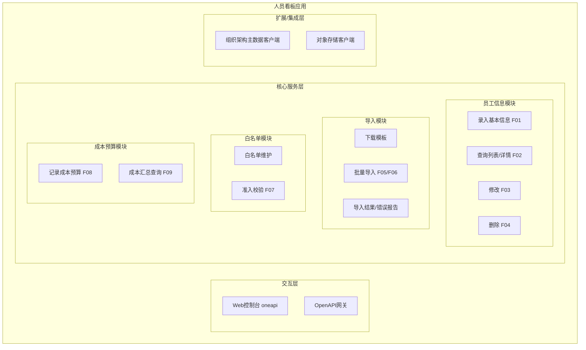
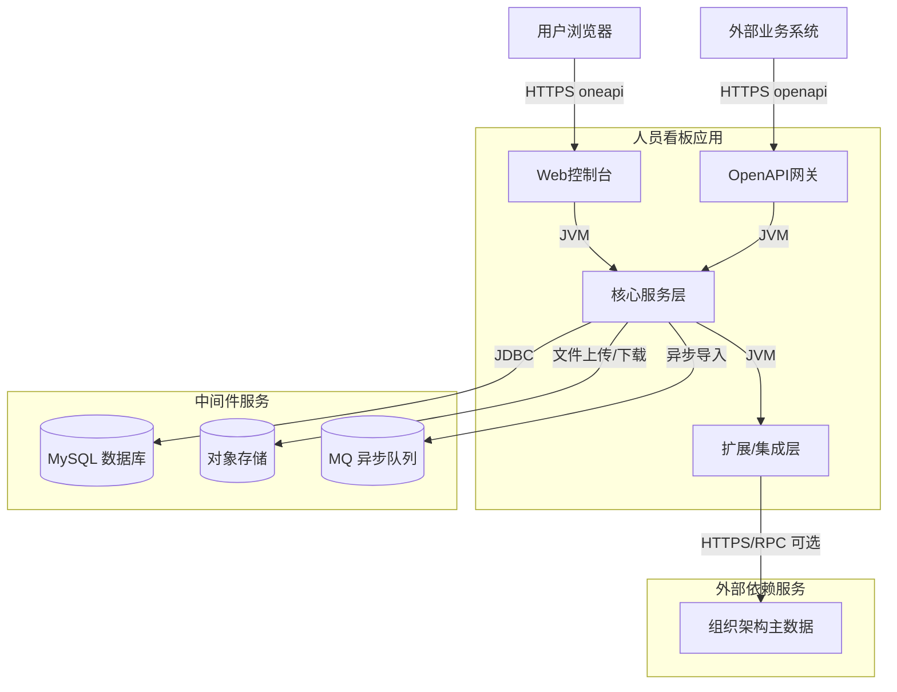
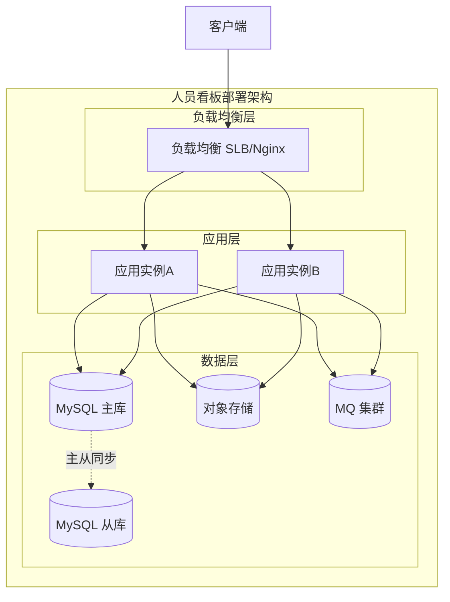
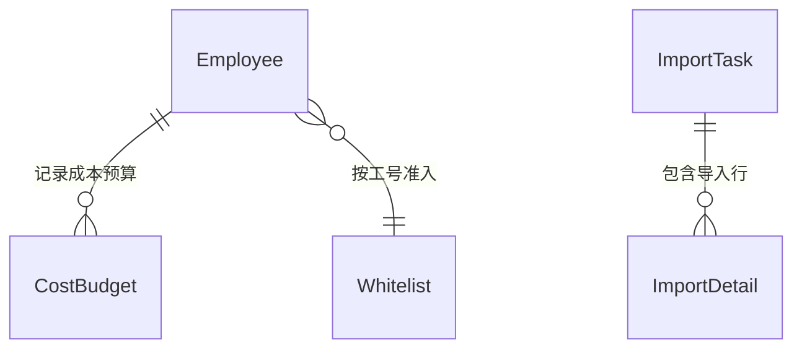
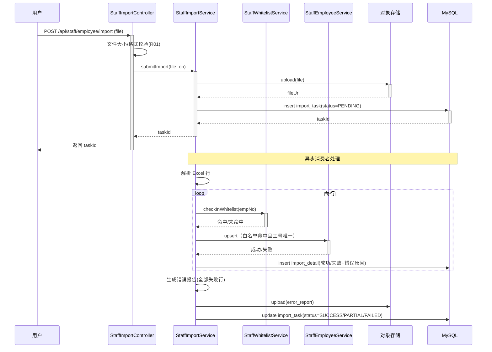
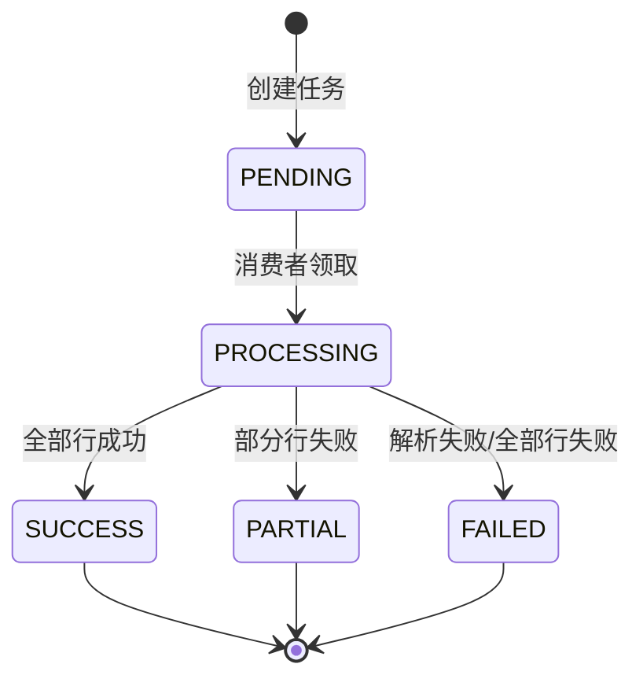

> **文档元信息**
>
> | 项目 | 内容 |
> |------|------|
> | 文档版本 | v1.0 |
> | 作者 | AiWork（系分生成节点） |
> | 创建日期 | 2026-10-28 |
> | 需求来源 | 任务需求描述「开发一个人员看板，有入口记录员工的基本信息以及增删改查，支持导入以及记录成本预算--白名单、批量导入」；参考文件《产品空间迭代测分-测试用例汇总.md》 |
> | 评审状态 | 待评审 |

# 人员看板 系分设计

## 1. 需求与范围

### 背景与目标

当前员工基本信息、成本预算等信息分散在线下或各系统，缺少统一的人员看板。本需求建设「人员看板」，提供统一入口录入员工基本信息并支持增删改查，支持员工信息导入（含白名单控制、批量导入），同时可记录每位员工的成本预算，便于管理者在统一看板中查看人员与成本情况。

### 核心功能

- 提供统一入口录入员工基本信息，并对员工信息进行增删改查。
- 支持员工信息导入（Excel 模板），其中包含白名单控制与批量导入能力。
- 记录每位员工的成本预算（如月度/年度、成本类型、金额等）。

### 约束与非功能要求

- 登录态校验、垂直/水平权限控制。
- 敏感信息（身份证号、手机号等）加密存储、展示脱敏。
- 导入文件大小、行数限制；批量导入需异步执行并给出错误报告，不阻塞主流程。
- 员工工号唯一性约束（同租户内）。
- 高可用、可监控、可灰度、可应急。

### 排除范围

- 不涉及薪资发放/资金流：成本预算仅做记录与汇总展示，不做实际付款。
- 不涉及复杂组织架构管理：部门/岗位采用基础字段，人员来源主数据由外部组织架构系统提供（可选集成），不在本系统内维护完整组织树。
- 不涉及考勤、绩效等其他 HR 领域。
- 不涉及前端页面视觉稿实现细节（本设计为后端与数据方案）。

### 需求功能清单与优先级

| 编号 | 功能点 | 优先级 | PRD 原始描述/章节 | 备注 |
|------|--------|--------|-------------------|------|
| F01 | 员工基本信息录入（入口） | P0 | 「有入口记录员工的基本信息」 | 新增员工，含基本信息字段 |
| F02 | 员工基本信息查询（列表/详情） | P0 | 「增删改查」 | 分页列表 + 详情 |
| F03 | 员工基本信息修改 | P0 | 「增删改查」 | 更新基本信息 |
| F04 | 员工基本信息删除 | P0 | 「增删改查」 | 逻辑删除（状态置离职/删除标记） |
| F05 | 员工信息导入（下载模板、上传解析、结果反馈） | P0 | 「支持导入」 | Excel 导入 |
| F06 | 批量导入 | P0 | 「批量导入」 | 异步批量处理 + 错误报告 |
| F07 | 白名单控制 | P1 | 「白名单」 | 白名单维护与准入校验 |
| F08 | 成本预算记录 | P0 | 「记录成本预算」 | 按员工记录成本预算 |
| F09 | 成本预算查询汇总 | P1 | 「记录成本预算」 | 看板侧成本汇总展示 |

### 假设与待确认项

| 编号 | 假设/待确认内容 | 当前假设 | 确认状态 |
|------|-----------------|----------|----------|
| A01 | 需求中「白名单」的业务语义 | 假设白名单为「员工准入白名单」：只有工号在白名单内的员工，才允许被录入看板/导入/记录成本预算；未加白名单的录入或导入被拒绝并提示。 | 待确认 |
| A02 | 「支持导入以及记录成本预算--白名单、批量导入」的句法切分 | 假设功能点为：导入、成本预算记录、白名单、批量导入四项；「白名单」为导入与录入的准入控制能力。 | 待确认 |
| A03 | 员工「成本预算」的颗粒度 | 假设为按「员工 × 年度 × 月份 × 成本类型」记录金额，支持月度为 0 表示全年。 | 待确认 |
| A04 | 技术栈 | 结合仓库既有 Java/SpringBoot/MyBatis 工程，假设采用 Java + Spring Boot + MyBatis(MyBatis-Plus) + MySQL 单体分层架构，部署为容器化。 | 待确认 |
| A05 | 删除语义 | 假设员工删除为逻辑删除（状态置离职/停用），保留历史成本预算记录。 | 待确认 |
| A06 | 白名单未命中时导入策略 | 假设批量导入中未加白名单的行记为失败行并写入错误报告，不阻断白名单内其它行导入（可配置为全量阻断，见可灰度/可应急）。 | 待确认 |
| A07 | 工号仅在白名单校验时对接组织架构主数据 | 默认不强制对接外部主数据；仅做白名单内工号存在性校验（可期权对接 hrorg）。 | 待确认 |

---

## 2. 架构与模块

### 功能架构



- 交互层说明：Web 控制台提供 oneapi 接口（`/api/staff/...`）供前端页面调用；OpenAPI 网关对外提供 `/openapi/staff/...` 供外部系统批量导入与员工查询。
- 核心服务层说明：四个模块单一职责。员工信息模块为基础数据；导入模块依赖白名单模块做准入校验，并落库员工信息；成本预算模块依赖员工信息模块获取员工身份。
- 扩展/集成层说明：对象存储用于存放导入文件与错误报告；组织架构主数据客户端用于可选的工号存在性校验。

**模块清单**

| 模块 | 职责 | 依赖 |
|------|------|------|
| 员工信息模块 | 员工基本信息的录入、查询、修改、删除 | 白名单模块（准入校验）、对象存储（文件） |
| 导入模块 | 模板下载、文件解析、批量导入、结果反馈 | 员工信息模块、白名单模块、对象存储 |
| 白名单模块 | 白名单维护、导入/录入时的准入校验 | 无 |
| 成本预算模块 | 记录、查询、汇总员工的成本预算 | 员工信息模块 |

### 应用集成架构



**集成关系说明：**

| 调用方 | 被调用方 | 协议 | 接口类型 | 说明 |
|--------|----------|------|----------|------|
| 用户浏览器 | 应用 Web 控制台 | HTTPS | oneapi REST | 员工/白名单/成本预算/导入操作 |
| 外部业务系统 | 应用 OpenAPI 网关 | HTTPS | openapi REST | 外部批量导入、员工查询 |
| 应用核心服务层 | MySQL | JDBC | SQL | 员工、预算、白名单、导入任务数据 |
| 应用核心服务层 | 对象存储 | HTTPS | 文件 API | 导入文件与错误报告存储 |
| 应用核心服务层 | MQ | 消息协议 | 异步消息 | 批量导入异步任务 |
| 应用扩展/集成层 | 组织架构主数据 | HTTPS/RPC | 集成接口 | 可选：工号存在性校验 |

### 部署架构



**部署说明：**
- **负载均衡层**：SLB/Nginx 统一入口，多实例无单点（假设：假设私有化容器化部署，K8s 多副本；若公有云则同城双机房）。
- **应用层**：无状态服务，多副本水平扩展；导入异步消费者可独立扩容。
- **数据层**：MySQL 主从（读多写少场景读走从库），对象存储与 MQ 均为托管集群，无单点。

---

## 3. 数据模型与存储

### 实体清单

| 实体名称 | 实体说明 | 所属模块 | 与其他实体的关系 |
|----------|----------|----------|-----------------|
| 员工信息（employee） | 员工基本信息主数据 | 员工信息模块 | 一对多：员工信息 → 成本预算；员工信息 → 白名单（按工号关联） |
| 员工成本预算（cost_budget） | 员工按年度/月份/成本类型记录的预算金额 | 成本预算模块 | 多对一：关联员工信息 |
| 白名单（whitelist） | 允许录入/导入的工号白名单 | 白名单模块 | 与员工信息按工号逻辑关联（非外键） |
| 导入任务（import_task） | 一次批量导入的任务头信息 | 导入模块 | 一对多：导入任务 → 导入明细 |
| 导入明细（import_detail） | 导入任务中每一行的处理结果 | 导入模块 | 多对一：关联导入任务 |

### 实体关系图



**模型说明：**
- 白名单与员工信息按 `tenant_id + emp_no` 逻辑关联，不使用数据库外键（遵循 db 规范禁用外键）。
- 导入任务与明细为异步导入的审计与错误反馈载体。
- 成本预算同一员工同一期间同一成本类型唯一（唯一索引保证幂等）。

---

## 4. 接口设计（总体列表）

### 4.1 oneapi（Web 控制台接口）

| 编号 | 接口名称 | 方法 | 路径 | 模块 |
|------|----------|------|------|------|
| W01 | 录入员工基本信息 | POST | /api/staff/employee | 员工信息模块 |
| W02 | 修改员工基本信息 | PUT | /api/staff/employee/{employeeId} | 员工信息模块 |
| W03 | 删除员工（逻辑删除） | DELETE | /api/staff/employee/{employeeId} | 员工信息模块 |
| W04 | 查询员工详情 | GET | /api/staff/employee/{employeeId} | 员工信息模块 |
| W05 | 分页查询员工列表 | POST | /api/staff/employee/list | 员工信息模块 |
| W06 | 批量导入员工 | POST | /api/staff/employee/import | 导入模块 |
| W07 | 下载导入模板 | GET | /api/staff/employee/import/template | 导入模块 |
| W08 | 查询导入任务结果 | GET | /api/staff/employee/import/task/{taskId} | 导入模块 |
| W09 | 记录员工成本预算 | POST | /api/staff/cost/budget | 成本预算模块 |
| W10 | 分页/汇总查询成本预算 | POST | /api/staff/cost/budget/list | 成本预算模块 |
| W11 | 新增白名单 | POST | /api/staff/whitelist | 白名单模块 |
| W12 | 分页查询白名单 | POST | /api/staff/whitelist/list | 白名单模块 |
| W13 | 移除白名单 | DELETE | /api/staff/whitelist/{whitelistId} | 白名单模块 |

### 4.2 OpenAPI（对外接口）

| 编号 | 接口名称 | 方法 | 路径 | 模块 |
|------|----------|------|------|------|
| O01 | 外部批量导入员工 | POST | /openapi/staff/employee/import | 导入模块 |
| O02 | 按工号查询员工 | GET | /openapi/staff/employee/{empNo} | 员工信息模块 |

### 4.3 内部接口（Service 层）

| 编号 | 接口名称 | 类 | 方法签名 |
|------|----------|------|----------|
| S01 | 录入员工 | StaffEmployeeService | create(StaffEmployeeDTO dto) |
| S02 | 修改员工 | StaffEmployeeService | update(Long employeeId, StaffEmployeeDTO dto) |
| S03 | 逻辑删除员工 | StaffEmployeeService | delete(Long employeeId) |
| S04 | 查询员工详情 | StaffEmployeeService | getDetail(Long employeeId) |
| S05 | 分页查询员工 | StaffEmployeeService | pageQuery(StaffQueryDTO query) |
| S06 | 批量导入 | StaffImportService | submitImport(MultipartFile file, Operator op) |
| S07 | 记录成本预算 | StaffCostService | recordBudget(CostBudgetDTO dto) |
| S08 | 查询成本预算 | StaffCostService | queryBudget(CostQueryDTO query) |
| S09 | 新增白名单 | StaffWhitelistService | add(WhitelistDTO dto) |
| S10 | 白名单准入校验 | StaffWhitelistService | checkInWhitelist(String empNo) |

### 4.4 集成接口（Integration 层）

| 编号 | 接口名称 | 类 | 方法签名 | 说明 |
|------|----------|------|----------|------|
| I01 | 工号存在性校验 | OrgClient | getEmployeeByEmpNo(String empNo) | 可选对接组织架构主数据 |
| I02 | 文件上传/下载 | ObjectStorageClient | upload(InputStream, String fileName) | 导入文件与错误报告存储 |

---

## 5. 功能模块设计

## 5.0 全局约定

- **错误码格式**：`{MODULE}_{SEQ}`，本系统统一使用前缀 `STAFF`，如 `STAFF_001`。
- **通用出参结构**：`{ code, msg, data }`（code=0 成功，非 0 失败；msg 为提示信息；data 为业务数据）。
- **通用入参分页**：`pageNum`、`pageSize`（默认 1/20，上限 200）。
- **租户隔离**：所有业务表含 `tenant_id`，接口从登录态上下文注入，不信任前端传参。
- **审计字段**：`gmt_create`、`gmt_modified` 由代码层维护。

| 模块 | 错误码前缀 |
|------|-----------|
| 员工信息模块 | STAFF_EMP |
| 导入模块 | STAFF_IMP |
| 成本预算模块 | STAFF_COST |
| 白名单模块 | STAFF_WL |

### 5.0.1 全局技术选型方案对比

> 说明：以下为跨模块的关键技术选型。选型原则为「先复用仓库/组织既有能力，再考虑引入新依赖」，均给出 2~3 个方案 + 优劣对比 + 推荐结论并直接采用推荐方案。

| 决策项 | 方案 A | 方案 B | 方案 C | 推荐 | 推荐理由 |
|--------|--------|--------|--------|------|----------|
| 后端技术栈 | Java + Spring Boot + MyBatis-Plus + MySQL 单体分层 | Java + Spring Boot + MyBatis + JPA | 拆微服务 | 方案 A | 仓库既有工程为 SpringBoot/MyBatis(Plus)，复用成本低；单体分层契合当前数据量级，后续可按模块拆分 |
| Web 接口形态 | oneapi REST（/api）+ OpenAPI REST（/openapi） | 纯 OpenAPI | RPC | 方案 A | 与组织既有 oneapi/openapi 约定一致，前端与外部系统均可复用 |
| 数据访问 | MyBatis + XML Mapper 参数化 | 手写 JDBC | MyBatis Generator 全量生成 | 方案 A | 参数化天然防 SQL 注入，调试可控，避免全量生成带来的维护负担 |
| 分页 | PageHelper 插件 | 手写 limit/offset SQL | 游标分页 | 方案 A | 仓库既有 PageHelper 使用经验，接入成本最低 |
| 租户隔离 | 查询时注入 tenant_id + 唯一索引含 tenant_id | 逻辑外键 | 独立库分租户 | 方案 A | 与 db 规范（无外键）一致，实现简单，暂不需分库 |
| 文件存储 | 对象存储（OSS）+ 客户端接口抽象 | 应用本地磁盘 | 直接存 DB（BLOB） | 方案 A | 支持私有化 OSS/MinIO 切换，避免多实例磁盘不一致，避免 DB 大字段膨胀 |
| 异步基础设施 | MQ 消息队列 + 消费者 | 应用内线程池 | 定时任务扫描任务表 | 方案 A | 解耦、可重试；线程池重启丢队列、定时扫描有延迟 |

模块特有决策在第 5.1~5.4 各「技术选型」小节补充，不在此重复。

## 5.1 员工信息模块

### 5.1.1 表结构设计

#### 5.1.1.1 staff_employee（员工基本信息表）

| 字段名 | 数据类型 | 约束 | 默认值 | 说明 |
|--------|----------|------|--------|------|
| id | bigint | PK, 自增 | - | 系统自增主键 |
| tenant_id | varchar(32) | NOT NULL | '' | 租户ID |
| emp_no | varchar(32) | NOT NULL | '' | 工号 |
| name | varchar(64) | NOT NULL | '' | 姓名 |
| dept_id | bigint | NULL | NULL | 部门ID（可选） |
| dept_name | varchar(128) | NULL | NULL | 部门名称（冗余） |
| position | varchar(64) | NULL | NULL | 岗位 |
| hire_date | date | NULL | NULL | 入职日期 |
| email | varchar(128) | NULL | NULL | 邮箱 |
| phone | varchar(32) | NULL | NULL | 手机号（脱敏展示） |
| id_card_no | varchar(64) | NULL | NULL | 身份证号（加密存储） |
| status | tinyint | NOT NULL | 1 | 状态：1-在职/正常，0-离职/停用 |
| source | varchar(16) | NOT NULL | 'MANUAL' | 来源：MANUAL-手动录入，IMPORT-导入 |
| gmt_create | datetime | NOT NULL | CURRENT_TIMESTAMP | 创建时间 |
| gmt_modified | datetime | NOT NULL | CURRENT_TIMESTAMP | 修改时间 |

**索引：**
- UK：`uk_tenant_emp_no` (tenant_id, emp_no)
- IDX：`idx_tenant_name` (tenant_id, name)
- IDX：`idx_tenant_status` (tenant_id, status)
- IDX：`idx_dept_id` (dept_id)

#### 5.1.1.2 员工信息模块 枚举与常量定义

| 枚举名称 | 取值 | 含义 | 关联字段 |
|----------|------|------|----------|
| EmployeeStatus | NORMAL / LEAVE | 正常在职 / 离职停用 | staff_employee.status（1/0） |
| EmployeeSource | MANUAL / IMPORT | 手动录入 / 批量导入 | staff_employee.source |

### 5.1.2 接口详细设计

#### W01 录入员工基本信息

- **URI**：POST /api/staff/employee
- **描述**：新增员工，录入基本信息
- **入参**：

| 参数名称 | 类型 | 是否必填 | 描述 |
|----------|------|----------|------|
| empNo | String | 是 | 工号 |
| name | String | 是 | 姓名 |
| deptId | Long | 否 | 部门ID |
| deptName | String | 否 | 部门名称 |
| position | String | 否 | 岗位 |
| hireDate | String | 否 | 入职日期（yyyy-MM-dd） |
| email | String | 否 | 邮箱 |
| phone | String | 否 | 手机号 |
| idCardNo | String | 否 | 身份证号 |

- **出参**：

| 参数名称 | 类型 | 描述 |
|----------|------|------|
| code | Integer | 结果码，0 成功 |
| msg | String | 提示信息 |
| data | Object | 新员工 `{ employeeId }` |

- **错误码**：

| 错误码 | 说明 |
|--------|------|
| STAFF_EMP_001 | 参数校验失败（缺 empNo/name 等） |
| STAFF_EMP_002 | 工号已存在 |
| STAFF_WL_001 | 该工号未在白名单内，禁止录入 |
| STAFF_EMP_003 | 工号不存在（可选：对接组织架构主数据时） |

- **业务规则**：R01 工号同租户唯一；R02 录入前校验白名单准入；R03 身份证号加密存储、手机号脱敏展示。
- **请求示例**：

```json
{
  "empNo": "E10001",
  "name": "张三",
  "deptName": "技术部",
  "position": "工程师",
  "hireDate": "2026-01-05",
  "email": "zhangsan@example.com",
  "phone": "13800000000",
  "idCardNo": "110101199001011234"
}
```

- **响应示例**：

```json
{
  "code": 0,
  "msg": "SUCCESS",
  "data": { "employeeId": 1001 }
}
```

#### W02 修改员工基本信息

- **URI**：PUT /api/staff/employee/{employeeId}
- **描述**：按 ID 更新员工基本信息
- **入参**：同 W01（不含 empNo，empNo 不可修改；如需换工号需走删除+新增）
- **出参**：`{ code, msg, data: null }`
- **错误码**：`STAFF_EMP_004`（员工不存在或已删除）
- **业务规则**：R04 工号不可修改；R05 修改前校验员工存在且未删除。

#### W03 删除员工（逻辑删除）

- **URI**：DELETE /api/staff/employee/{employeeId}
- **描述**：逻辑删除员工（状态置离职/停用，保留历史）
- **出参**：`{ code, msg, data: null }`
- **错误码**：`STAFF_EMP_004`
- **业务规则**：R06 逻辑删除，不物理删除；R07 已删除员工不可重复删除（幂等）。

#### W04 查询员工详情

- **URI**：GET /api/staff/employee/{employeeId}
- **描述**：查询员工详情，敏感字段脱敏返回
- **出参**：`data` 为员工明细对象（phone、idCardNo 脱敏）
- **错误码**：`STAFF_EMP_004`

#### W05 分页查询员工列表

- **URI**：POST /api/staff/employee/list
- **描述**：分页查询员工列表，支持按姓名/工号/部门/状态筛选
- **入参**：

| 参数名称 | 类型 | 是否必填 | 描述 |
|----------|------|----------|------|
| pageNum | Integer | 否 | 页码，默认 1 |
| pageSize | Integer | 否 | 每页条数，默认 20，上限 200 |
| empNo | String | 否 | 工号模糊匹配 |
| name | String | 否 | 姓名模糊匹配 |
| deptId | Long | 否 | 部门ID |
| status | Integer | 否 | 状态 |

- **出参**：`data` 含 `{ total, records }`，records 中手机号/身份证脱敏。

### 5.1.3 子功能详细设计

#### 5.1.3.1 录入员工基本信息（F01）

- 处理时序图

```mermaid
sequenceDiagram
    participant U as 用户
    participant C as StaffEmployeeController
    participant S as StaffEmployeeService
    participant W as StaffWhitelistService
    participant M as StaffEmployeeMapper
    participant DB as MySQL

    U->>+C: POST /api/staff/employee
    C->>C: 参数校验(R01)
    C->>+S: create(dto)
    S->>+W: checkInWhitelist(empNo)
    W-->>-S: 白名单命中结果
    alt 未命中
        S-->>C: STAFF_WL_001
    else 命中
        S->>+M: selectCountByEmpNo(tenantId, empNo)
        M->>DB: SELECT count
        DB-->>-M: 0
        M-->>-S: 不存在
        S->>S: 敏感字段加密(身份证)
        S->>+M: insert(entity)
        M->>DB: INSERT
        DB-->>-M: 生成 id
        M-->>-S: 成功
        S-->>-C: employeeId
        C-->>-U: 响应
    end
```

**业务规则：**

| 规则编号 | 规则描述 | 校验时机 | 不满足时的处理 |
|----------|----------|----------|--------------|
| R01 | empNo/name 必填非空 | 始终 | 返回 STAFF_EMP_001 |
| R02 | 工号必须在白名单内 | 创建时 | 返回 STAFF_WL_001，提示未加白名单 |
| R03 | 工号同租户唯一 | 创建时 | 返回 STAFF_EMP_002 |
| R04 | 员工未逻辑删除才可录入 | 创建时 | 返回 STAFF_EMP_002 |
| R05 | 身份证号加密存储 | 创建时 | 内部处理后落库 |

**异常场景：**

| 异常场景 | 处理方式 |
|----------|----------|
| 唯一索引并发冲突 | 捕获唯一键冲突异常，返回 STAFF_EMP_002（幂等处理） |
| 组织架构主数据不可用（可选集成） | 降级为仅白名单校验，记录告警 |

**并发控制（数据写入）：**
- 并发场景：同一工号被并发录入。
- 控制策略：数据库唯一索引 `uk_tenant_emp_no` 兜底 + 应用层先查后插 + 捕获唯一键冲突幂等返回。

### 5.1.4 技术选型方案对比

| 决策项 | 方案 A | 方案 B | 方案 C | 推荐 | 推荐理由 |
|--------|--------|--------|--------|------|----------|
| 敏感字段（身份证号）加密 | 应用层字段加密（AES，密钥托管） | 数据库透明加密 | 不加密 | A | 满足合规且不影响检索；应用层加密更可控、便于对接脱敏 SDK |
| 员工列表查询 | 数据库直查 + 必要索引 | 列表缓存 Redis | 全表缓存 | A | 员工数据实时性要求高、总量可控，直查+索引足够，缓存增加一致性负担 |
| 详情/列表脱敏 | 出参统一脱敏（DTO 层 + 日志脱敏） | 前端脱敏 | 存储脱敏 | A | 后端 DTO 层统一脱敏 + 日志拦截，保证源头安全 |

### 5.1.5 模块自检

**完备性对账表：**

| 功能点 | 是否已设计 | 对应产出 |
|--------|-----------|----------|
| F01 录入基本信息 | 是 | 5.1.2 W01、5.1.3.1 时序图 + 业务规则 |
| F02 查询列表/详情 | 是 | 5.1.2 W04/W05 |
| F03 修改 | 是 | 5.1.2 W02 |
| F04 删除 | 是 | 5.1.2 W03 |

**过度设计检查：**

| 检查项 | 结论 | 说明 |
|--------|------|------|
| 是否引入不必要的服务拆分 | 否 | 单体分层即可，未拆分微服务 |
| 是否引入不必要的缓存 | 否 | 员工信息实时性高，直查即可 |
| 是否设计多余状态机 | 否 | 员工仅简单状态（在职/离职），无需状态机 |

## 5.2 白名单模块

### 5.2.1 表结构设计

#### 5.2.1.1 staff_whitelist（员工准入白名单表）

| 字段名 | 数据类型 | 约束 | 默认值 | 说明 |
|--------|----------|------|--------|------|
| id | bigint | PK, 自增 | - | 系统自增主键 |
| tenant_id | varchar(32) | NOT NULL | '' | 租户ID |
| emp_no | varchar(32) | NOT NULL | '' | 工号 |
| name | varchar(64) | NOT NULL | '' | 姓名（冗余，便于展示） |
| reason | varchar(255) | NULL | NULL | 加入原因 |
| status | tinyint | NOT NULL | 1 | 状态：1-启用，0-停用 |
| gmt_create | datetime | NOT NULL | CURRENT_TIMESTAMP | 创建时间 |
| gmt_modified | datetime | NOT NULL | CURRENT_TIMESTAMP | 修改时间 |

**索引：**
- UK：`uk_tenant_emp_no` (tenant_id, emp_no)
- IDX：`idx_tenant_status` (tenant_id, status)

#### 5.2.1.2 白名单模块 枚举与常量定义

| 枚举名称 | 取值 | 含义 | 关联字段 |
|----------|------|------|----------|
| WhitelistStatus | ENABLED / DISABLED | 启用 / 停用 | staff_whitelist.status（1/0） |

### 5.2.2 接口详细设计

#### W11 新增白名单

- **URI**：POST /api/staff/whitelist
- **描述**：将工号加入准入白名单
- **入参**：

| 参数名称 | 类型 | 是否必填 | 描述 |
|----------|------|----------|------|
| empNo | String | 是 | 工号 |
| name | String | 是 | 姓名 |
| reason | String | 否 | 加入原因 |

- **出参**：`data` 含 `{ whitelistId }`
- **错误码**：`STAFF_WL_002`（该工号已在白名单）
- **业务规则**：R01 工号同租户唯一；R02 已停用再次加入时复启用。

#### W12 分页查询白名单

- **URI**：POST /api/staff/whitelist/list
- **描述**：分页查询白名单，支持按工号/姓名/状态筛选。
- **入参**：`pageNum`、`pageSize`、`empNo`、`name`、`status`

#### W13 移除白名单

- **URI**：DELETE /api/staff/whitelist/{whitelistId}
- **描述**：移除白名单（逻辑停用，保留历史）
- **出参**：`{ code, msg, data: null }`
- **业务规则**：R03 移除为逻辑停用（status=0），新录入/导入立即受控；已存在员工不受影响。

### 5.2.3 子功能详细设计

#### 5.2.3.1 白名单准入校验（F07）

- 处理时序图

```mermaid
sequenceDiagram
    participant M as 业务模块(录入/导入)
    participant W as StaffWhitelistService
    participant DB as MySQL

    M->>+W: checkInWhitelist(empNo)
    W->>+DB: SELECT count WHERE tenant_id=? AND emp_no=? AND status=1
    DB-->>-W: count
    alt count > 0
        W-->>-M: true（命中）
    else
        W-->>-M: false（未命中）
    end
```

**业务规则：**

| 规则编号 | 规则描述 | 校验时机 | 不满足时的处理 |
|----------|----------|----------|--------------|
| R01 | 仅启用状态白名单生效 | 校验时 | 停用视为未命中 |
| R02 | 白名单校验按 tenant_id + emp_no 精确匹配 | 校验时 | 未命中返回 false |

**异常场景：**

| 异常场景 | 处理方式 |
|----------|----------|
| 白名单查询异常 | 采用快速失败（默认不放行），返回系统异常并告警 |

**并发控制：** 白名单仅低频维护，读多写少，唯一索引防重复，无高并发风险（原因：维护操作低频）。

### 5.2.4 技术选型方案对比

| 决策项 | 方案 A | 方案 B | 方案 C | 推荐 | 推荐理由 |
|--------|--------|--------|--------|------|----------|
| 白名单准入校验加速 | DB 直查 | Redis 缓存 + DB 兜底 | 本地缓存 Caffeine | B | 读多写少，Redis 缓存命中高且多实例一致；本地缓存各实例独立易不一致 |
| 白名单维护 | 单独维护表 + 管理接口 | 配置文件静态列表 | 硬编码 | A | 动态增删、可审计、可被灰度开关控制，满足「白名单」需求 |

**缓存一致性说明（选型 B 配套）：** 白名单写操作（新增/停用）时主动失效 Redis 缓存，读侧设置合理 TTL；缓存击穿防护：校验热点工号加锁或短暂缓存「未命中」空值，防同一工号高频穿透。

### 5.2.5 模块自检

**完备性对账表：**

| 功能点 | 是否已设计 | 对应产出 |
|--------|-----------|----------|
| F07 白名单准入校验 | 是 | 5.2.2 W11/W12/W13、5.2.3.1 时序图 + 业务规则 |

**过度设计检查：**

| 检查项 | 结论 | 说明 |
|--------|------|------|
| 是否引入分布式锁 | 否 | 白名单低频维护，唯一索引防重复即可 |
| 是否引入复杂审批流 | 否 | 白名单维护为直接管理操作，需求未要求审批 |

## 5.3 导入模块

### 5.3.1 表结构设计

#### 5.3.1.1 staff_import_task（导入任务表）

| 字段名 | 数据类型 | 约束 | 默认值 | 说明 |
|--------|----------|------|--------|------|
| id | bigint | PK, 自增 | - | 系统自增主键 |
| tenant_id | varchar(32) | NOT NULL | '' | 租户ID |
| file_name | varchar(255) | NOT NULL | '' | 原始文件名 |
| file_url | varchar(512) | NULL | NULL | 导入文件对象存储地址 |
| total | int | NOT NULL | 0 | 总行数 |
| success | int | NOT NULL | 0 | 成功行数 |
| fail | int | NOT NULL | 0 | 失败行数 |
| status | tinyint | NOT NULL | 0 | 状态：0-待处理，1-处理中，2-成功，3-部分成功，4-失败 |
| error_file_url | varchar(512) | NULL | NULL | 错误报告文件地址 |
| operator | varchar(64) | NULL | NULL | 操作人 |
| gmt_create | datetime | NOT NULL | CURRENT_TIMESTAMP | 创建时间 |
| gmt_modified | datetime | NOT NULL | CURRENT_TIMESTAMP | 修改时间 |

**索引：**
- IDX：`idx_tenant_status` (tenant_id, status)
- IDX：`idx_tenant_create` (tenant_id, gmt_create)

#### 5.3.1.2 staff_import_detail（导入明细表）

| 字段名 | 数据类型 | 约束 | 默认值 | 说明 |
|--------|----------|------|--------|------|
| id | bigint | PK, 自增 | - | 系统自增主键 |
| tenant_id | varchar(32) | NOT NULL | '' | 租户ID |
| task_id | bigint | NOT NULL | 0 | 导入任务ID |
| row_no | int | NOT NULL | 0 | 行号 |
| emp_no | varchar(32) | NULL | NULL | 工号 |
| name | varchar(64) | NULL | NULL | 姓名 |
| raw_data | text | NULL | NULL | 原始行数据（JSON） |
| status | tinyint | NOT NULL | 0 | 处理状态：1-成功，0-失败 |
| error_msg | varchar(512) | NULL | NULL | 失败原因 |
| gmt_create | datetime | NOT NULL | CURRENT_TIMESTAMP | 创建时间 |

**索引：**
- IDX：`idx_task_id` (task_id)

#### 5.3.1.3 导入模块 枚举与常量定义

| 枚举名称 | 取值 | 含义 | 关联字段 |
|----------|------|------|----------|
| ImportTaskStatus | PENDING / PROCESSING / SUCCESS / PARTIAL / FAILED | 待处理/处理中/成功/部分成功/失败 | staff_import_task.status（0/1/2/3/4） |
| ImportDetailStatus | SUCCESS / FAIL | 成功/失败 | staff_import_detail.status（1/0） |

### 5.3.2 接口详细设计

#### W06 批量导入员工

- **URI**：POST /api/staff/employee/import
- **描述**：上传 Excel 文件，异步解析并批量导入，返回任务ID
- **入参**：

| 参数名称 | 类型 | 是否必填 | 描述 |
|----------|------|----------|------|
| file | MultipartFile | 是 | Excel 文件（xlsx） |

- **出参**：`data` 含 `{ taskId }`
- **错误码**：

| 错误码 | 说明 |
|--------|------|
| STAFF_IMP_001 | 文件为空/格式不支持 |
| STAFF_IMP_002 | 文件大小超限 |
| STAFF_IMP_003 | 文件解析失败/模板不匹配 |
| STAFF_IMP_004 | 任务不存在 |

- **业务规则**：R01 文件限大小（默认 10MB）、限行数（默认 5000）；R02 每行做白名单准入校验与工号唯一校验；R03 未命中白名单的行记为失败并写入错误报告（遵循假设 A06）。

- **请求示例**（multipart）：

```
Content-Type: multipart/form-data
file: <binary excel>
```

- **响应示例**：

```json
{
  "code": 0,
  "msg": "SUCCESS",
  "data": { "taskId": 5001 }
}
```

#### W07 下载导入模板

- **URI**：GET /api/staff/employee/import/template
- **描述**：下载员工导入 Excel 模板（含表头：工号、姓名、部门、岗位、入职日期、邮箱、手机号、成本预算等）
- **出参**：文件流

#### W08 查询导入任务结果

- **URI**：GET /api/staff/employee/import/task/{taskId}
- **描述**：查询导入任务进度与结果，可下载错误报告
- **出参**：`data` 含 `{ taskId, status, total, success, fail, errorFileUrl }`

### 5.3.3 子功能详细设计

#### 5.3.3.1 批量导入（F05/F06）

- 处理时序图



**业务规则：**

| 规则编号 | 规则描述 | 校验时机 | 不满足时的处理 |
|----------|----------|----------|--------------|
| R01 | 文件大小与行数限制 | 上传时 | 返回 STAFF_IMP_002 |
| R02 | 工号非空、格式合法 | 逐行解析 | 标记失败行 |
| R03 | 白名单准入校验 | 逐行导入 | 未命中标记失败行 |
| R04 | 工号同租户唯一 | 逐行导入 | 已在看板则跳过或更新（按「以文件为准」更新模式处理） |
| R05 | 成本预算字段（如有）一并导入 | 逐行导入 | 预算行校验失败仅影响该行，不影响员工信息行 |

**异常场景：**

| 异常场景 | 处理方式 |
|----------|----------|
| 文件解析失败（模板列缺失） | 整任务标记 FAILED，返回 STAFF_IMP_003 |
| 对象存储上传失败 | 任务标记 FAILED，返回系统异常并告警 |
| 异步消费者宕机/中断 | 任务停留 PROCESSING，通过超时巡检重试或置 FAILED 可重投 |

**并发控制（数据写入）：**
- 并发场景：同一批导入与手动录入针对同一工号并发；或同一文件重复提交。
- 控制策略：工号唯一索引 + 行级幂等（emp_no 维度 upsert）；任务级幂等键（文件 MD5 + 租户）防重复提交。

**状态机设计（导入任务存在状态字段）：**



**状态流转规则：**

| 当前状态 | 目标状态 | 流转条件 | 前置校验 | 触发动作 |
|----------|----------|----------|----------|----------|
| PENDING | PROCESSING | 异步消费者领取任务 | 任务未超时 | 更新状态 |
| PROCESSING | SUCCESS | 全部行导入成功 | 无失败行 | 汇总统计 |
| PROCESSING | PARTIAL | 存在失败行但仍成功导入部分 | 有成功也有失败 | 生成错误报告 |
| PROCESSING | FAILED | 解析失败或全部行失败 | 无可导入成功行 | 生成错误报告 |

### 5.3.4 技术选型方案对比

| 决策项 | 方案 A | 方案 B | 方案 C | 推荐 | 推荐理由 |
|--------|--------|--------|--------|------|----------|
| 异步实现 | MQ 消息队列 | 应用内线程池 | 定时任务扫描任务表 | A | 解耦、可重试、消费者独立扩容；线程池重启丢队列、定时扫描有延迟 |
| Excel 解析 | EasyExcel（流式） | 原生 POI | CSV 简单解析 | A | 流式读取内存友好，支持大文件与错误行定位；CSV 不适合中文/类型校验 |
| 文件存储 | 对象存储（OSS） | 本地磁盘 | DB BLOB | A | 多实例共享、可审计、不膨胀 DB |
| 重复提交幂等 | 文件 MD5 + 租户幂等键 | 让用户手动去重 | 乐观锁 | A | 简单可靠，防同文件重复导入（可叠加任务状态校验） |

### 5.3.5 模块自检

**完备性对账表：**

| 功能点 | 是否已设计 | 对应产出 |
|--------|-----------|----------|
| F05 导入（模板/上传/结果反馈） | 是 | 5.3.2 W06/W07/W08 |
| F06 批量导入（异步 + 错误报告） | 是 | 5.3.3.1 时序图 + 业务规则 + 状态机 |

**过度设计检查：**

| 检查项 | 结论 | 说明 |
|--------|------|------|
| 是否引入全量校验引擎 | 否 | 逐行白名单/唯一校验即可，未引入规则引擎 |
| 是否引入断点续传 | 否 | 导入任务可重投即可，规模未要求断点续传 |

## 5.4 成本预算模块

### 5.4.1 表结构设计

#### 5.4.1.1 staff_cost_budget（员工成本预算表）

| 字段名 | 数据类型 | 约束 | 默认值 | 说明 |
|--------|----------|------|--------|------|
| id | bigint | PK, 自增 | - | 系统自增主键 |
| tenant_id | varchar(32) | NOT NULL | '' | 租户ID |
| employee_id | bigint | NOT NULL | 0 | 员工ID（关联 staff_employee.id） |
| emp_no | varchar(32) | NOT NULL | '' | 工号（冗余） |
| year | smallint | NOT NULL | 0 | 预算年度（如 2026） |
| month | tinyint | NOT NULL | 0 | 预算月份（1-12，0 表示全年） |
| cost_type | varchar(32) | NOT NULL | '' | 成本类型 |
| amount | decimal(14,2) | NOT NULL | 0.00 | 金额 |
| currency | char(3) | NOT NULL | 'CNY' | 币种 |
| remark | varchar(255) | NULL | NULL | 备注 |
| gmt_create | datetime | NOT NULL | CURRENT_TIMESTAMP | 创建时间 |
| gmt_modified | datetime | NOT NULL | CURRENT_TIMESTAMP | 修改时间 |

**索引：**
- UK：`uk_emp_year_month_type` (employee_id, year, month, cost_type)
- IDX：`idx_tenant_year_month` (tenant_id, year, month)
- IDX：`idx_employee_id` (employee_id)

#### 5.4.1.2 成本预算模块 枚举与常量定义

| 枚举名称 | 取值 | 含义 | 关联字段 |
|----------|------|------|----------|
| CostType | SALARY / SOCIAL_INSURANCE / BONUS / ALLOCATION / OTHER | 工资/社保/奖金/部门分摊/其他 | staff_cost_budget.cost_type |

### 5.4.2 接口详细设计

#### W09 记录员工成本预算

- **URI**：POST /api/staff/cost/budget
- **描述**：为员工记录一条成本预算（同维度已存在则按金额覆盖，保证幂等）
- **入参**：

| 参数名称 | 类型 | 是否必填 | 描述 |
|----------|------|----------|------|
| employeeId | Long | 是 | 员工ID |
| year | Integer | 是 | 年度 |
| month | Integer | 是 | 月份（0 表示全年） |
| costType | String | 是 | 成本类型 |
| amount | BigDecimal | 是 | 金额 |
| currency | String | 否 | 币种，默认 CNY |
| remark | String | 否 | 备注 |

- **出参**：`data` 含 `{ budgetId }`
- **错误码**：`STAFF_COST_001`（员工不存在）、`STAFF_COST_002`（金额非法≤0 或超精度）
- **业务规则**：R01 员工必须存在且未删除；R02 金额为正数，小数两位；R03 同员工+期间+类型幂等更新。

- **请求示例**：

```json
{
  "employeeId": 1001,
  "year": 2026,
  "month": 1,
  "costType": "SALARY",
  "amount": 20000.00,
  "currency": "CNY",
  "remark": "1月工资预算"
}
```

- **响应示例**：

```json
{
  "code": 0,
  "msg": "SUCCESS",
  "data": { "budgetId": 3001 }
}
```

#### W10 分页/汇总查询成本预算

- **URI**：POST /api/staff/cost/budget/list
- **描述**：按员工/年度/月份/成本类型查询，支持汇总（sum(amount)）
- **入参**：`pageNum`、`pageSize`、`employeeId`、`empNo`、`year`、`month`、`costType`、`aggregate`（布尔，true 时返回汇总金额）
- **出参**：`data` 含 `{ total, records, summaryAmount }`

### 5.4.3 子功能详细设计

#### 5.4.3.1 记录成本预算（F08）

- 处理时序图

```mermaid
sequenceDiagram
    participant U as 用户
    participant C as StaffCostController
    participant S as StaffCostService
    participant E as StaffEmployeeService
    participant M as StaffCostBudgetMapper
    participant DB as MySQL

    U->>+C: POST /api/staff/cost/budget
    C->>C: 参数校验(R02)
    C->>+S: recordBudget(dto)
    S->>+E: getDetail(employeeId)
    E-->>-S: 员工存在性
    alt 员工不存在
        S-->>C: STAFF_COST_001
    else 存在
        S->>+M: upsertByDimension(employeeId,year,month,costType)
        M->>DB: INSERT ... ON DUPLICATE KEY UPDATE / 先查后插
        DB-->>-M: 结果
        M-->>-S: budgetId
        S-->>-C: budgetId
        C-->>-U: 响应
    end
```

**业务规则：**

| 规则编号 | 规则描述 | 校验时机 | 不满足时的处理 |
|----------|----------|----------|--------------|
| R01 | 员工存在且未删除 | 记录时 | 返回 STAFF_COST_001 |
| R02 | 金额为正数且两位小数 | 记录时 | 返回 STAFF_COST_002 |
| R03 | 同维度幂等更新 | 记录时 | 覆盖金额并更新 gmt_modified |

**异常场景：**

| 异常场景 | 处理方式 |
|----------|----------|
| 并发更新同维度金额 | 唯一键 + upsert 保证原子性，后写覆盖 |

**并发控制（数据写入）：**
- 并发场景：同一员工同一维度被并发写。
- 控制策略：唯一索引 `uk_emp_year_month_type` + upsert 原子写（后写覆盖，记录预算场景可接受）。

### 5.4.4 技术选型方案对比

| 决策项 | 方案 A | 方案 B | 方案 C | 推荐 | 推荐理由 |
|--------|--------|--------|--------|------|----------|
| 预算幂等写入 | 唯一键 + 原子 upsert | 先查后插 + 版本号 | 乐观锁（version） | A | 唯一键天然保证「员工+期间+类型」唯一，原子写幂等；版本/乐观锁对覆盖式记录无必要 |
| 金额精度 | decimal(14,2) | double | 字符串 | A | 遵循 db 规范禁止 double，金额用 decimal 精确表达 |
| 汇总查询 | SQL SUM 聚合 | 预计算汇总表 | 应用层累加 | A | 数据量级下 SQL 聚合足够，避免预计算维护成本 |

### 5.4.5 模块自检

**完备性对账表：**

| 功能点 | 是否已设计 | 对应产出 |
|--------|-----------|----------|
| F08 记录成本预算 | 是 | 5.4.2 W09、5.4.3.1 时序图 + 业务规则 |
| F09 成本预算查询汇总 | 是 | 5.4.2 W10 |

**过度设计检查：**

| 检查项 | 结论 | 说明 |
|--------|------|------|
| 是否引入预算审批流 | 否 | 需求仅「记录」，未要求审批 |
| 是否引入多维分析引擎 | 否 | 汇总用 SQL 聚合即可，未引 OLAP |

## 5.5 跨模块调用链

导入模块跨越白名单模块与员工信息模块的调用链已在「批量导入」时序图体现：上传 → 落任务 → 异步逐行 → 白名单校验 → 员工信息 upsert → 明细记录 → 错误报告。

---

## 6. 非功能性需求设计

### 6.1 高可用性
- 应用层多副本无状态部署，任一实例宕机由负载均衡摘除，不影响整体服务。
- 组织架构主数据不可用时降级为仅白名单校验（见假设 A07），保证录入可用。
- 对象存储不可用时导入直接失败并提示重试，不影响已上线功能。

### 6.2 可扩展性
- 员工信息、成本预算、白名单、导入各模块职责单一，可独立演进或拆分服务。
- 对象存储接口抽象（本设计以 ObjectStorageClient 表述），便于 OSS/MinIO/自建存储切换。
- 成本类型采用字符串枚举，后续新增成本类型无需改表结构。

### 6.3 稳定性/可靠性
- 批量导入异步化，大文件不阻塞请求线程，任务可重试、可追溯。
- 接口统一幂等约束（员工工号唯一、预算维度唯一、任务文件 MD5 幂等）。
- 限流：对写接口（录入/导入/预算记录）按「租户 + 接口」限流，防突发流量打垮 DB；导入上传文件大小与行数双重上限。
- 降级：MQ/对象存储不可用时，导入接口返回可重试错误而主流程不崩溃；白名单缓存失效时回源 DB 兜底。
- 缓存防护：白名单校验引入 Redis 后，热点工号加锁或缓存空值防击穿；缓存 key 加随机 TTL 防雪崩。

### 6.4 安全性设计

#### 6.4.1 账户系统方案
- 复用组织统一认证（登录态由全局统一拦截器校验），本系统不重复自建账户体系（假设：对齐组织既有 SSO）。

#### 6.4.2 授权&访问控制
##### 是否实现水平权限检查
- 涉及员工/预算/白名单等按租户隔离，查询一律注入 `tenant_id`，防止跨租户越权；员工详情按 `tenant_id + employee_id` 双重条件访问。

##### 是否实现垂直权限检查
- 通过角色控制：普通成员可查询、录入；管理员/成本负责人可维护白名单与成本预算；删除员工需管理员。

##### 是否检查登录态
- `/api/staff/**` 全局统一拦截器校验登录态（模板与错误报告下载同受控）。

#### 6.4.3 数据防护方案
##### 是否对敏感数据加密存储
- 身份证号加密存储（字段加密/密钥托管）；手机号按需脱敏存储。

##### 是否对敏感数据展示进行脱敏
- 员工列表/详情对姓名（仅名隐去）、身份证、手机号脱敏展示；日志打印对敏感字段脱敏。

#### 6.4.4 网络安全与 SQL 注入防护
- 网络访问收敛：`/openapi/**` 仅对可信外部系统开放，经网关做签名验签/租户识别；`/api/**` 走内部链路受登录态与 CSRF/越权防护。
- SQL 注入防护：数据访问统一走 MyBatis 参数绑定，禁止字符串拼接 SQL；mapper 全量走 `#{}` 预编译参数。
- 防重放/越权：OpenAPI 请求加时间戳与签名防重放；水平权限按 tenant_id + 资源 ID 双重校验，垂直权限按角色注解校验。

### 6.5 监控/统计/日志/告警
- 关键监控点：导入成功率/失败率、接口耗时（P95/P99）、错误码分布、成本预算写入量。
- 告警点：导入 FAILED、对象存储/MQ 不可用、唯一键冲突突增（疑似批量重复）、数据库慢查询。

### 6.6 性能设计
- 员工列表/详情为核心读路径：依赖必要索引（工号/姓名/状态/部门）直查，员工规模可控时无需列表缓存。
- 白名单准入为高频读路径（录入/导入每行触发）：采用 Redis 缓存 + DB 兜底，命中率高；写操作主动失效缓存。
- 缓存防护：热点工号加锁或缓存空值防击穿；缓存 key 加随机 TTL 防雪崩（详见 6.3）。
- 预算汇总走 SQL SUM 聚合（带 tenant_id+year+month 索引），避免应用层全量拉取累加。
- 批量导入通过 MQ 削峰：上传与解析解耦，消费者根据任务量弹性扩缩容，防止大量文件拉满接口线程。

---

## 7. 变更三板斧

### 7.1 可监控
- 埋点：录入/导入/预算记录调用的结果与耗时埋点；导入链路对「调用对象存储、调用白名单校验、调用员工 upsert」分别记录结果与耗时。
- 导入任务状态与明细落库，可查询可追溯；错误报告可下载。

### 7.2 可灰度
- 方案对比：
  - 方案 A（推荐）：按租户尾号灰度开启「强制白名单校验 + 批量导入」能力，先小范围验证，再全量放开。理由：改动集中在准入与导入开关，风险可控、可快速回退。
  - 方案 B：全局开关一次全量。理由：实现简单，但影响面大。
- 采用方案 A，白名单校验与批量导入均支持开关配置。

### 7.3 可应急
- 提供「白名单强校验开关」：异常时可临时关闭强制校验，保证现有已录员工数据可用。
- 提供「导入功能开关」：导入异常时可临时关闭入口，保留手动录入。
- 回滚兜底：发布包可回退；表结构采用新增列（不删除不缩窄原列），保证新旧版本兼容。
- 回滚依赖关注：逻辑删除的员工状态、预算唯一键变更均向后兼容，回滚不影响历史数据。

---

## 附录：设计自检结论（Step 9 checklist 摘要）

| 检查项 | 结论 |
|------|------|
| 模块划分合理性 | 通过：四模块单一职责，无循环依赖（成本→员工为单向，导入→白名单/员工单向） |
| 依赖关系合理性 | 通过：下游对象存储/主数据不可用时均有降级方案 |
| 单点（部署层面） | 通过：多副本 + 负载均衡 + 数据层托管集群 |
| 表模型范式 | 通过：满足 3NF，允许 dept_name/emp_no 少量冗余以提升查询 |
| 隐私安全 | 通过：身份证加密、手机/姓名脱敏 |
| 兼容性（接口） | 通过：新增接口，不修改既有契约 |
| 兼容性（表） | 通过：全新表，无历史兼容负担；后续变更遵循新增列不缩窄原则 |
| 数据迁移 | 通过：全新表，导入模板提供初始化来源 |
| 一致性（功能点） | 通过：F01-F09 均有对应设计 |
| 一致性（表） | 通过：Step 3 五个实体均完整定义表结构 |
| 一致性（接口） | 通过：Step 4 接口均在设计中有详细定义 |
| 一致性（枚举） | 通过：枚举与表字段注释一致 |
| 状态机完整性 | 通过：import_task 状态机完整，无孤岛状态 |
| 并发风险 | 通过：唯一索引 + upsert + 幂等键覆盖主要写场景 |
| 单点（定时任务） | 通过：导入消费者多副本 + 超时巡检重投，无单点 |
| 非功能可行性 | 通过：异步导入、缓存/脱敏、限流方案可落地 |
| 三板斧-可监控 | 通过：埋点与任务明细可落地 |
| 三板斧-可灰度 | 通过：按租户尾号灰度（方案 A 推荐） |
| 三板斧-可应急 | 通过：白名单/导入开关 + 发布包回退，越简单越快 |